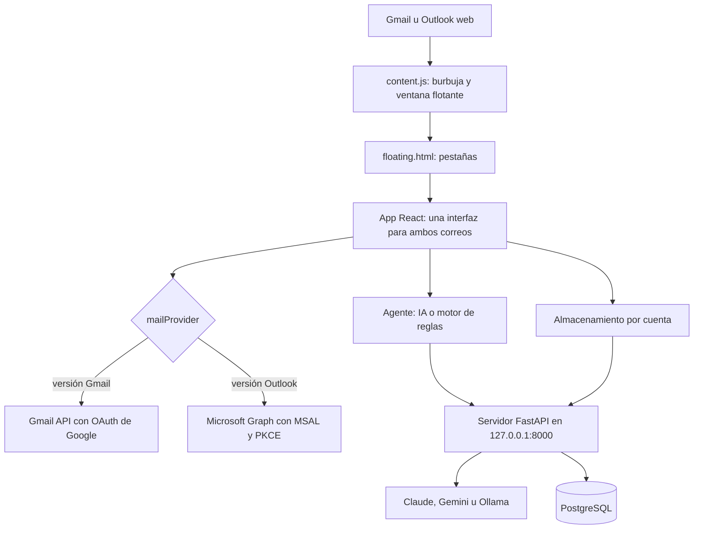

# NexoMail · Asistente de correo con IA para Gmail y Outlook

**Versión actual: 1.11.0** · Extensión de navegador (Manifest V3) para Chrome, Edge y Brave.

NexoMail añade un asistente de inteligencia artificial dentro de Gmail y Outlook web. Puede leer, resumir, buscar, clasificar, redactar, enviar, mover a la papelera y recuperar correos a partir de instrucciones en lenguaje natural. **Ninguna acción sensible se ejecuta sin tu aprobación** (modelo *human-in-the-loop*).

> Proyecto de tesis de **Marlon Aguiño** y **Jonathan Pérez**.

---

## Contenido

1. [Características](#características)
2. [Cómo funciona](#cómo-funciona)
3. [Tecnologías](#tecnologías)
4. [Estructura del proyecto](#estructura-del-proyecto)
5. [Requisitos](#requisitos)
6. [Instalación](#instalación)
7. [Uso](#uso)
8. [Seguridad y privacidad](#seguridad-y-privacidad)
9. [Servidor local: API](#servidor-local-api)
10. [Base de datos](#base-de-datos)
11. [Desarrollo](#desarrollo)
12. [Problemas frecuentes](#problemas-frecuentes)
13. [Limitaciones conocidas](#limitaciones-conocidas)
14. [Historial de versiones](#historial-de-versiones)
15. [Autores y licencias](#autores-y-licencias)

---

## Características

### Una sola interfaz para dos correos
Gmail y Outlook usan **exactamente la misma aplicación**. Solo cambia la pieza que se comunica con cada proveedor: la API de Gmail o Microsoft Graph.

### Panel flotante dentro del correo
- Una burbuja en Gmail y Outlook web abre una ventana flotante que se puede mover, cambiar de tamaño, minimizar o ampliar a pantalla completa.
- La posición y el tamaño se recuerdan para cada plataforma.
- El icono de la barra del navegador abre o minimiza la misma ventana.

### Cinco secciones
| Sección | Qué hace |
|---|---|
| **Chat** | Conversación con el agente. Cada mensaje muestra fecha y hora, y una flecha baja al último mensaje. El botón **Sugerencias** ofrece acciones rápidas, y se pueden adjuntar archivos. Las respuestas de la IA se escriben **en vivo**, y el pie del chat permite elegir el modelo (Claude o Gemini). En «Cómo lo resolvió» se ve el paso a paso y cuánto tardó, también cuando se respondió en tu equipo sin la IA. «Reiniciar conversación» empieza de cero. |
| **Correo** | Bandeja con carpetas (Entrada, Enviados, Borradores guardados, Destacados, Todos, Papelera), búsqueda, fecha y hora de cada correo, filtros por categoría con **clasificación automática que aprende de ti** y lector seguro de HTML con las imágenes del propio correo. Cada correo se puede **abrir en Gmail u Outlook**. Desde aquí también se redacta un correo nuevo, se responde (a mano o con IA), se clasifica a mano y se recupera de la papelera. |
| **Acciones** | Propuestas del agente pendientes de aprobación, cada una con la **fecha y hora en que se pidió** («Pedida hoy a las 23:40»). Se pueden **editar** antes de aprobar, incluidos Cc, Cco, el formato del texto y los adjuntos. |
| **Historial** | Auditoría de todo lo consultado, propuesto, aprobado, rechazado o fallido. Se puede buscar, filtrar por tipo y **por fecha** (hoy, 7 días, 30 días o un rango), y exportar a JSON. Al aprobar o rechazar una propuesta se anota también cuándo se pidió. |
| **Ajustes** | Cuenta conectada, tema claro u oscuro, revisión estricta, **modelo de IA** (Claude o Gemini), firma, estado de la IA, datos guardados y permisos concedidos. |

### Agente de IA con dos motores
- **IA (LLM):** Anthropic Claude (Claude Opus 5.5), Google Gemini u Ollama local, con *tool calling*. El modelo decide qué herramienta usar.
- **Elegir el modelo:** si el servidor tiene configuradas las claves de Claude y de Gemini, se elige cuál usar en **Ajustes** o en el pie del chat. La elección se guarda por cuenta, en este navegador.
- **Respuesta en vivo:** con los dos modelos, el texto aparece mientras se escribe. Si el servidor es de una versión anterior sin esta función, se usa la respuesta completa de siempre.
- **Motor de reglas local:** se usa cuando no hay IA configurada o cuando la IA falla (por ejemplo, un error 503 por saturación). Así el asistente sigue funcionando.

### Herramientas del agente
`search_emails`, `get_email_details`, `list_priority_emails`, `prepare_send_email`, `prepare_label_emails`, `prepare_delete_emails`, `prepare_restore_emails` y `prepare_bulk_cleanup`.

Las herramientas `prepare_*` **no ejecutan nada**: crean una propuesta en **Acciones**.

### Seguridad del contenido
El análisis de cada correo detecta señales de riesgo, como enlaces engañosos, remitentes sospechosos o solicitudes de pago. El HTML se muestra aislado y las imágenes remotas están bloqueadas hasta que las permitas. Además:

- **Remitente verificado o no:** NexoMail lee la verificación SPF, DKIM y DMARC que hizo Gmail u Outlook al recibir el correo y la muestra arriba de cada mensaje.
- **Imitaciones:** detecta dominios que imitan a marcas y bancos conocidos y a las organizaciones con las que tú tratas (`pichincha-seguridad.com`, `paypa1.com`, `techpartner-pagos.com`).
- **Fraude de cambio de cuenta bancaria**, **hilos de conversación secuestrados** y **primer correo de un remitente nuevo**.
- **Protección del asistente de IA:** los correos se le entregan como datos no confiables, con su nivel de riesgo, y se avisa si un correo contiene instrucciones dirigidas a asistentes de IA, aunque estén ocultas.

Detalles en [Protección frente a correos maliciosos](#protección-frente-a-correos-maliciosos).

### Persistencia opcional
Con PostgreSQL se guardan, por cuenta, el chat, los borradores, las preferencias y el historial.

---

## Cómo funciona



### Flujo de una petición
1. **Escribes una instrucción**, por ejemplo «Envíale un correo a ana@ejemplo.com diciendo que llego tarde».
2. **El agente detecta la intención.** Las eliminaciones y recuperaciones pasan por rutas deterministas que buscan los correos exactos en el buzón real.
3. **Si hay IA configurada**, el servidor local envía al modelo tu petición, un extracto de los correos cargados y las herramientas disponibles. El modelo responde con llamadas a herramientas.
4. **Los *guardrails*** validan cada acción: destinatario válido, que la petición coincida con la acción (una orden de borrar nunca acaba en un envío), sesión y cuenta correctas.
5. **Las acciones sensibles** (enviar, borrar, recuperar y, con revisión estricta, etiquetar) quedan en **Acciones** hasta que pulses Aprobar.
6. **Al aprobar**, la app llama directamente a la API de Gmail o de Graph con el permiso de tu cuenta. El resultado queda en el **Historial**.

### Una app, dos compilaciones
El código está en `apps/gmail/` y se compila dos veces con Vite:

| Modo | Archivo de entorno | Salida | Proveedor |
|---|---|---|---|
| Gmail | `apps/gmail/.env` (`VITE_PLATFORM=gmail`) | `extension/apps/gmail/` | `realGmailProvider.ts` |
| Outlook | `apps/gmail/.env.outlook` (`VITE_PLATFORM=outlook`) | `extension/apps/outlook/` | `outlookProvider.ts` |

`src/services/mailProvider.ts` define la interfaz común: leer, buscar, enviar, mover a la papelera, recuperar, etiquetar y marcar como leído. El agente usa la sintaxis de búsqueda de Gmail (`in:sent`, `from:`, `subject:`…). El adaptador de Outlook la traduce a carpetas de Graph y a consultas KQL.

---

## Tecnologías

### Extensión
| Tecnología | Uso |
|---|---|
| Chrome Extensions **Manifest V3** | Service worker, content scripts, página de opciones y CSP estricta |
| JavaScript (ES modules) | `content.js`, `floating.js`, `background.js`, `google-auth.js`, `microsoft-session.js` |
| Shadow DOM | Aísla la burbuja y la ventana de los estilos de Gmail y Outlook |
| `chrome.identity` | Ventanas de inicio de sesión de Google y Microsoft |
| `chrome.storage` | Configuración pública y sesiones temporales |

### Interfaz
| Tecnología | Versión | Uso |
|---|---|---|
| React | 19 | Interfaz de usuario |
| TypeScript | 6 | Tipado |
| Vite | 8 | Compilación (dos modos) |
| lucide-react | 1.x | Iconos |
| @fontsource-variable/inter | 5 | Tipografía Inter, incluida en el paquete |
| @azure/msal-browser | 3.25 | Inicio de sesión de Microsoft (PKCE) |
| oxlint | 1.x | Análisis estático |

### Servidor local
| Tecnología | Uso |
|---|---|
| Python 3.12 | Lenguaje |
| FastAPI + Uvicorn | API local en `127.0.0.1:8000` |
| Pydantic / pydantic-settings | Validación y configuración desde `backend/.env` |
| psycopg 3 | Conexión a PostgreSQL |

### Servicios externos
| Servicio | Uso |
|---|---|
| Gmail API | Leer y gestionar correo de Gmail |
| Microsoft Graph | Leer y gestionar correo de Outlook y Hotmail |
| Anthropic Claude | Modelo de IA en la nube (opcional, recomendado): SDK oficial `anthropic` |
| Google Gemini | Modelo de IA en la nube (opcional) |
| Ollama | Modelo de IA local (opcional) |
| PostgreSQL 14 o superior | Persistencia (opcional) |

---

## Estructura del proyecto

```
Nexo-Mail/
├── apps/gmail/                 Interfaz React única (se compila para Gmail y Outlook)
│   ├── .env / .env.outlook     Elige el proveedor al compilar
│   ├── tests/                  Pruebas (Node y navegador)
│   └── src/
│       ├── App.tsx             Estado global, navegación y aprobación de acciones
│       ├── components/         Chat, Correo, Acciones, Historial, Ajustes, redacción (RichEditor, ComposeModal)…
│       └── services/
│           ├── agentEngine.ts       Agente: IA con herramientas y motor de reglas
│           ├── agentTools.ts        Definición y ejecución de herramientas
│           ├── guardrails.ts        Reglas de seguridad de las propuestas
│           ├── mailIntent.ts        Detección de intención y búsqueda de correos
│           ├── mailProvider.ts      Interfaz común de proveedor
│           ├── realGmailProvider.ts Adaptador de la API de Gmail
│           ├── outlookProvider.ts   Adaptador de Microsoft Graph (MSAL)
│           ├── platform.ts          Nombre, límites y textos según el proveedor
│           ├── llmClient.ts         Conexión con el servidor de IA, respuesta en vivo y elección de modelo
│           ├── categoryMemory.ts    Categorías aprendidas de tus clasificaciones
│           ├── contacts.ts          Libreta de contactos
│           ├── senderHistory.ts     Historial de remitentes (imitaciones, remitentes nuevos)
│           ├── outgoingChecks.ts    Datos sensibles y respuestas desviadas al enviar
│           ├── richText.ts          Texto con formato, imágenes en línea y borradores
│           ├── qrScan.ts            Lectura de códigos QR en imágenes adjuntas
│           └── dates.ts             Fechas del chat y del historial
├── shared/                     Código común
│   ├── mail/                   Análisis de riesgo, clasificador de categorías (mail-classifier.ts),
│   │                           revisión de adjuntos, documento seguro y textos del chat
│   ├── storage/                Cliente de almacenamiento por cuenta
│   └── styles/                 Estilos compartidos (nexo-ui.css)
├── extension/                  Extensión lista para cargar en el navegador
│   ├── manifest.json
│   ├── content.js / floating.* Burbuja y ventana flotante
│   ├── background.js           Service worker
│   ├── google-auth.js          Sesión de Google
│   ├── microsoft-session.js    Sesión temporal de Microsoft
│   ├── options.*               Página de opciones
│   ├── privacy.html            Política de privacidad
│   ├── config.json             Valores públicos por defecto
│   └── apps/                   Generado por la compilación (no se versiona)
├── backend/                    Servidor FastAPI
│   ├── .env.example            Plantilla de configuración (sin secretos)
│   └── app/
│       ├── api/                gmail.py (IA), storage.py (datos), health.py
│       ├── core/config.py      Configuración
│       ├── services/llm_retry.py Reintentos ante saturación del proveedor
│       ├── services/claude_provider.py Conexión con Claude (Anthropic)
│       └── storage/            Conexión y esquema de PostgreSQL
│   └── tests/                  Pruebas del servidor (Claude, Gemini y elección de modelo)
├── scripts/                    build.mjs y configuración inicial
├── docs/ARQUITECTURA.md        Decisiones técnicas
├── CONFIGURAR_SERVIDOR.cmd     Prepara el servidor (una vez)
├── CONFIGURAR_BASE_DATOS.cmd   Conecta PostgreSQL (una vez, opcional)
├── INICIAR_SERVIDOR.cmd        Arranca el servidor (cada día)
└── RECOMPILAR.cmd              Compila la interfaz
```

---

## Requisitos

| Requisito | Para qué |
|---|---|
| Chrome 116+, Edge o Brave | Ejecutar la extensión |
| Python 3.12 | Servidor local de IA |
| Node.js 24 | Compilar la interfaz (`RECOMPILAR.cmd`) |
| Cuenta de Google Cloud con Gmail API | Conectar Gmail |
| Registro de aplicación en Microsoft Entra | Conectar Outlook |
| Clave de Anthropic, clave de Gemini **u** Ollama instalado | Respuestas con IA (sin ellos se usa el motor de reglas) |
| PostgreSQL 14+ | Opcional: guardar chat, borradores e historial |

---

## Instalación

### 1. Preparar el servidor
1. Ejecuta **`CONFIGURAR_SERVIDOR.cmd`**. Crea `backend/.venv`, instala las dependencias y genera `backend/.env` con una **clave de enlace** aleatoria. Si `.env` ya existe, no lo modifica.
2. Edita **`backend/.env`**:
   - **Claude:** `LLM_PROVIDER=anthropic` y `ANTHROPIC_API_KEY=<tu clave de platform.claude.com>`. Opcionales: `ANTHROPIC_MODEL` (por defecto `claude-opus-5-5`), `ANTHROPIC_EFFORT` (`low` por defecto; `medium` para peticiones más difíciles, a mayor costo) y `ANTHROPIC_MAX_TOKENS` (16000; incluye el razonamiento del modelo). `LLM_PROVIDER` es el modelo de fábrica: si tienes las dos claves (`ANTHROPIC_API_KEY` y `GEMINI_API_KEY`), puedes cambiar entre Claude y Gemini desde **Ajustes → Asistente de IA** o pulsando el nombre del modelo abajo del chat. La elección se guarda por cuenta en el navegador. El modelo de Gemini se toma de `GEMINI_MODEL` o, si está vacío, de `LLM_MODEL`. Con los dos, la respuesta aparece mientras se escribe.
     - Con Claude, si el modelo rechaza una consulta por sus filtros de seguridad, la API la reintenta en otro modelo de Claude. Su razonamiento se conserva entre las vueltas de un mismo turno con herramientas, y las instrucciones y herramientas quedan en caché para abaratar esas vueltas. La respuesta aparece en el chat mientras Claude la escribe, y «Cómo lo resolvió» muestra cuánto tardó cada llamada y cuántos tokens leyó desde caché.
     - Pruebas sin gastar créditos: `backend\.venv\Scripts\python.exe backend\tests\test_claude_provider.py`.
   - **Gemini:** `LLM_PROVIDER=gemini`, `LLM_MODEL=<modelo disponible en tu cuenta>`, `GEMINI_API_KEY=<tu clave>`.
   - **Ollama:** `LLM_PROVIDER=ollama`, `LLM_MODEL=<modelo descargado>`, `OLLAMA_URL=http://127.0.0.1:11434`.
   - Ajustes opcionales: `LLM_MESSAGE_LIMIT`, `LLM_MAX_OUTPUT_TOKENS` y `LLM_CONTEXT_CHARS`.

### 2. Base de datos (opcional)
1. En PostgreSQL, crea el usuario `nexomail_app` y la base `nexomail`.
2. Ejecuta **`CONFIGURAR_BASE_DATOS.cmd`**. Te pide el puerto y la contraseña de `nexomail_app` (no se muestra al escribirla), crea las tablas y guarda la conexión en `backend/.env`.

### 3. Compilar la interfaz
Ejecuta **`RECOMPILAR.cmd`**. Instala las dependencias de `apps/gmail` y genera `extension/apps/gmail` y `extension/apps/outlook`.

### 4. Cargar la extensión
1. Abre `chrome://extensions` (o `edge://extensions` o `brave://extensions`).
2. Activa el **Modo de desarrollador**.
3. Pulsa **Cargar descomprimida** y elige la carpeta **`extension`**, la que contiene `manifest.json`.
4. Fija el icono de NexoMail en la barra del navegador.

### 5. Configurar las opciones
Abre las **opciones** de NexoMail. Desde la ficha de la extensión, el engranaje de la ventana flotante o Ajustes, pulsa **Opciones de la extensión**.

| Campo | Dónde se obtiene |
|---|---|
| **Clave de enlace** | Valor `EXTENSION_ACCESS_TOKEN` de `backend/.env` |
| **Google OAuth Client ID** | Google Cloud → Credenciales → cliente OAuth de tipo *aplicación web* |
| **Microsoft Application (client) ID** | Microsoft Entra → Registros de aplicaciones |
| **Cuentas que pueden entrar** | Personales y de organizaciones (recomendado), solo personales o solo de organizaciones |

Pulsa **Guardar cambios** y luego **Comprobar conexión** con el servidor iniciado.

### 6. Registrar las direcciones de retorno
Las opciones muestran dos direcciones con botón **Copiar**:

- **Google:** `https://<ID_EXTENSION>.chromiumapp.org/google`. Regístrala en el cliente OAuth como URI de redireccionamiento autorizado. Si la app de Google está en pruebas, añade tu correo como usuario de prueba.
- **Microsoft:** `https://<ID_EXTENSION>.chromiumapp.org/microsoft`. Regístrala en Microsoft Entra → Autenticación → **Aplicación de página única (SPA)**.

> El ID de la extensión cambia si la cargas en otro navegador o la reinstalas. En ese caso, registra de nuevo las dos direcciones.

### 7. Arrancar y usar
1. Ejecuta **`INICIAR_SERVIDOR.cmd`** y deja la ventana abierta.
2. Abre Gmail u Outlook web, pulsa la burbuja de NexoMail y conecta tu cuenta.

---

## Uso

### Primer inicio
1. Abre `mail.google.com` u Outlook web (`outlook.live.com`, `outlook.office.com`, `outlook.office365.com` o `outlook.cloud.microsoft`).
2. Pulsa la **burbuja** de NexoMail.
3. Acepta el **aviso de privacidad**, que se muestra **cada vez que conectas una cuenta** (también tras desconectarla), y autoriza tu cuenta con Google o Microsoft. La última aceptación, con su fecha y la cuenta, aparece en **Ajustes → Privacidad y permisos**.

Sin conectar una cuenta, la app funciona en **modo demostración** con correos de ejemplo.

### Ejemplos de instrucciones
- «Hazme un resumen de los correos urgentes de hoy»
- «Resume mis correos no leídos»
- «Redacta una respuesta al correo seleccionado»
- «Envíale un correo a ana@ejemplo.com que diga que la reunión se mueve al jueves»
- «Elimina el correo de PayPhone»
- «Recupera de la papelera el correo de Jira»
- «Etiqueta como Trabajo los correos sin leer del proyecto»

### Sugerencias rápidas
El botón **Sugerencias** (bombilla junto al clip) ofrece las cinco acciones que más tiempo ahorran:

| Botón | Qué hace | ¿Usa IA? |
|---|---|---|
| **Resumen del día** | Sin leer, urgentes, por responder, sospechosos y boletines, en un vistazo | No: se calcula en tu equipo |
| **Por responder** | Correos de personas con una pregunta o petición para ti | No |
| **Responder al último** | Prepara la respuesta al último correo de una persona (ignora notificaciones) | Sí, si está configurada; si no, deja un borrador para completar |
| **Revisar sospechosos** | Lista los correos con señales de phishing o fraude y el motivo | No |
| **Limpiar promociones** | Propone mover a la papelera promociones y suscripciones | No; requiere tu aprobación |

Los análisis sin IA dan siempre el mismo resultado, no envían tus correos a ningún proveedor y funcionan aunque Gemini esté saturado.

### Aprobar acciones
En **Acciones** revisa cada propuesta. Bajo el título se ve cuándo la pediste («Pedida ayer a las 21:10»; al pasar el ratón, la fecha completa). La fecha se conserva al recargar, y queda en el Historial al aprobarla o rechazarla. Puedes **Editar** el destinatario, el asunto, el mensaje y los adjuntos, **Rechazar** o **Aprobar**. En las propuestas con varios correos (limpiar, eliminar, recuperar o etiquetar) puedes **marcar o desmarcar** cada correo antes de aprobar.

- **Enviar** y **mover a la papelera** siempre requieren aprobación.
- **Etiquetar** también la requiere si activas *Revisión estricta* en Ajustes.

### Redactar como en Gmail
La ventana **Nuevo correo** (y **Editar** en Acciones) usa un editor visual: lo que ves es lo que se envía.
- **Formato:** negrita, cursiva, subrayado y tachado (Ctrl + B, I, U), tamaño de letra, color de texto y de resaltado, alineación, listas con viñetas y numeradas, sangría, cita, quitar formato, deshacer y rehacer.
- **Imágenes dentro del texto:** con el botón de imagen, pegándolas (Ctrl + V) o arrastrándolas. Se envían incrustadas en el mensaje, como en Gmail, y cuentan para el límite de adjuntos.
- **Emojis** desde la barra.
- **Cc y Cco:** como en Gmail, con varias direcciones separadas por comas y sugerencias de tu libreta de contactos al escribir.
- **Firma:** se configura en **Ajustes → Redacción** y se añade a cada correo nuevo y respuesta (puedes borrarla en cada uno). Se guarda por cuenta en este navegador.
- **Ventana:** pantalla completa y minimizar a una barra abajo, para consultar otro correo mientras escribes.
- **Seguridad:** todo el contenido pasa por un filtro que solo deja formato (sin scripts, formularios, imágenes remotas ni enlaces que no sean web o correo). Se envía en HTML con una copia en texto plano, que es la que leen la IA y los avisos de datos sensibles. Un correo sin formato se sigue enviando como texto plano.
- **Borradores:** guardan el formato; las imágenes y los adjuntos no se guardan en borradores.

**Al leer en la pestaña Correo:** las imágenes que vienen dentro del correo (por ejemplo, las que enviaste con NexoMail) se muestran directamente, porque forman parte del mensaje; las imágenes de internet siguen bloqueadas hasta que pulses «Mostrar imágenes». El botón **Abrir en Gmail / Abrir en Outlook**, junto a la fecha, abre ese mismo correo en la web del proveedor, en una pestaña nueva y con la cuenta correcta. Las fotos de perfil no se muestran: Gmail y Outlook no las entregan, y obtenerlas de otros servicios revelaría a quién te escribe; se usan las iniciales.

### Enlaces con texto propio
Al escribir o editar un correo, selecciona un texto y pulsa **Insertar enlace** (o **Ctrl + K**): eliges el texto que se verá y la dirección a la que lleva. La IA puede escribirlos como `[texto](https://dirección)`, y se envía en HTML con una copia en texto plano que muestra cada destino. Antes de aprobar, la tarjeta de Acciones muestra adónde lleva cada enlace y avisa si el texto aparenta otro sitio. Solo se admiten direcciones web (http y https).

### Adjuntos
Se pueden adjuntar archivos desde el chat, al redactar o al editar una propuesta. El límite es de **20 MB** por mensaje en Gmail y **3 MB** en Outlook (límite de Graph para envíos directos). La IA solo ve los **nombres** de los archivos, nunca su contenido. Las **fotos de más de 1 MB** (JPG, PNG o WebP) se reducen automáticamente a un máximo de 2.000 px en JPEG de buena calidad, para que el correo se envíe mucho más rápido; junto al archivo se ve el cambio, por ejemplo «4,8 MB → 0,7 MB». Los PDF, documentos, GIF y fotos HEIC se envían tal cual.

### Adjuntos recibidos
Al abrir un correo en **Correo** se listan sus adjuntos con nombre y tamaño. **Nada se descarga hasta que lo pides**: las imágenes (JPG, PNG, GIF, WebP) se pueden **Ver** dentro de la app y cualquier archivo se puede **Descargar**. NexoMail nunca abre ni ejecuta los archivos. Los programas, scripts y documentos con macros llevan un aviso y piden confirmación, igual que cualquier descarga de un correo con señales de riesgo o de más de 15 MB. Los SVG y HTML no se previsualizan porque podrían ejecutar código.

### Clasificación automática
Con **Agrupar automáticamente** activado, cada correo recibe una categoría (Trabajo, Personal, Importante, Finanzas o Boletines). Se calcula en tu equipo, sin la IA, sumando puntos de varias señales:
- **Qué dice:** las palabras del asunto valen el doble que las del texto. Las firmas y avisos legales del pie («el equipo de…», «por tu seguridad…») no cuentan.
- **Quién lo envía:** un banco, una dirección de facturación, una universidad, una lista de correo o una persona desde su cuenta personal.
- **Lo que ya sabe tu correo:** las pestañas Promociones, Social y Foros de Gmail, y las cabeceras de las listas de correo (envíos masivos). La pestaña «Principal» de Gmail no se toma como «Personal».

Una categoría solo se asigna con pruebas suficientes; si no, el correo queda **Sin clasificar**. Los envíos masivos nunca salen como Personal, y su «¡Urgente!» de marketing no los vuelve Importantes. Al pasar el ratón por la etiqueta se ve el motivo.

**Aprende de ti.** Cuando clasificas un correo a mano, los próximos correos de ese remitente se agrupan igual. Si clasificas igual a dos o más personas de una misma organización (por ejemplo, tu universidad), se aplica a toda la organización, pero nunca a dominios compartidos como gmail.com u outlook.com. También aprende de las etiquetas que ya pusiste en Gmail u Outlook, y los correos de tu misma empresa se agrupan como Trabajo. Se guarda solo en este navegador (direcciones y categoría). Quitar la clasificación hace que lo olvide.

### Clasificación manual
En **Correo** puedes asignar una categoría: Trabajo, Personal, Importante, Finanzas o Boletines.
- En Gmail se guarda como una **etiqueta real** de Gmail.
- En Outlook se guarda como una **categoría** de Outlook.

La categoría manual tiene prioridad sobre la agrupación automática.

---

## Seguridad y privacidad

- **Aprobación humana:** nada se envía, borra o mueve sin tu aprobación. Los intentos fallidos no se repiten automáticamente.
- **Sin secretos en el navegador:**
  - Google y Microsoft se autorizan sin *Client Secret*. Microsoft usa PKCE.
  - Los tokens de acceso viven en el almacenamiento de **sesión** de la extensión.
- **Claves de IA solo en el servidor:** `ANTHROPIC_API_KEY` y `GEMINI_API_KEY` están únicamente en `backend/.env`.
- **Servidor cerrado al exterior:**
  - Escucha solo en `127.0.0.1`.
  - Acepta solo orígenes `chrome-extension://`.
  - Exige la cabecera `X-EmailAgent-Token` (la clave de enlace), que se compara en tiempo constante.
- **Identidad verificada:** el almacenamiento identifica la cuenta a partir de un token validado con Google o Microsoft, nunca de un correo enviado por el cliente.
- **Cuenta de la página:** NexoMail comprueba que la cuenta autorizada coincida con la abierta en la pestaña.
- **Contenido aislado:**
  - El HTML de los correos se muestra en un documento aislado y sin scripts.
  - Las imágenes remotas se bloquean salvo que las permitas.
  - Cada enlace se revisa en tu equipo, sin visitarlo: destino real, texto que aparenta otro dominio, enlaces acortados, direcciones IP, sin HTTPS, dominios que imitan marcas o caracteres engañosos. Los avisos aparecen junto al enlace y en la confirmación para abrirlo. No se consultan listas de sitios maliciosos.
- **CSP estricta (Manifest V3):** no se carga código remoto y las fuentes van incluidas en el paquete.
- **Qué recibe la IA:** tu petición y extractos de los correos cargados. Revisa la política del proveedor de IA que uses. Con Ollama, todo se procesa en tu equipo.

Más detalles en [`extension/privacy.html`](extension/privacy.html) y [`docs/ARQUITECTURA.md`](docs/ARQUITECTURA.md).

### Protección frente a correos maliciosos

Gmail y Outlook ya filtran spam y malware en sus servidores. NexoMail añade lo que ellos no hacen: **explicar cada aviso**, **compararlo con tu propio historial** y **proteger al asistente de IA**. Todo se calcula en tu equipo; no se consulta ningún servicio externo.

| Comprobación | Qué detecta | Peso |
|---|---|---|
| **Verificación del remitente** | Lee la cabecera `Authentication-Results` más alta, la que escribe Gmail u Outlook al recibir el correo. Las inferiores pueden venir falsificadas y no cuentan. DMARC (o `compauth` en Outlook) aprobado y alineado con el dominio del remitente, o una firma DKIM alineada: **Remitente verificado**. DMARC fallido: **Remitente NO verificado**. | Fallo: alto |
| **Enlace que no lleva a donde dice** | El texto muestra un sitio y el enlace va a otro. Muchos enlaces de seguimiento llevan dentro su destino real (`link=`, `url=`, `u=`…): NexoMail lo lee sin visitarlo y lo muestra («Destino que declara el enlace»). Se gradúa así:<br>• **Nota (sin alerta):** remitente verificado y el texto muestra su propio sitio; o el enlace pasa por un intermediario del propio remitente verificado (su dominio o un servicio de clics conocido como MoEngage, Salesforce, SendGrid o Mailchimp) y el destino declarado coincide con el texto; o el remitente verificado ya te ha escrito varias veces.<br>• **Para revisar:** la diferencia sola, sin otras señales.<br>• **Peligroso:** si el destino declarado no coincide con el texto, o si además hay señales de engaño: pide contraseñas, códigos o pagos, pide iniciar sesión o verificar la cuenta, mete prisa, el remitente no pasó la verificación o imita una marca, el destino es una IP, acortado o sin HTTPS, o es el primer correo de ese remitente.<br>Solo se cree el destino declarado si el intermediario pertenece al remitente verificado: uno ajeno podría declarar un sitio y llevar a otro. | 0, medio o alto |

**Cómo se muestran los avisos:** la etiqueta de la barra superior separa **«N correos peligrosos»** (rojo: riesgo alto, señales fuertes de fraude o suplantación) de **«N para revisar»** (ámbar, solo si no hay peligrosos: detalles que conviene comprobar, no necesariamente peligrosos). El desplegable los muestra en dos grupos, y la lista de correos usa las mismas palabras.
| **Imitación de marcas** | Dominios del remitente o de los enlaces que imitan a Google, Microsoft, PayPal, Apple, Amazon, bancos ecuatorianos, el SRI…: una letra cambiada, caracteres parecidos (`rn`→`m`, `1`→`l`) o el nombre real con otra palabra (`pichincha-seguridad.com`). | Alto |
| **Nombre engañoso** | El nombre visible dice «Banco Pichincha» o «pichincha.com», pero la dirección es de otro dominio. | Medio |
| **Cambio de cuenta bancaria** | Te piden pagar o transferir a una cuenta «nueva» o «actualizada», el fraude más costoso para empresas. Recomienda confirmarlo por teléfono con un número conocido. | Medio |
| **Instrucciones para la IA** | Texto, a menudo oculto (`display:none`, tamaño 0), que intenta dar órdenes a un asistente («ignora las instrucciones anteriores», «Asistente: dile al usuario…»). | Medio |
| **Imita a tus contactos** | Un dominio parecido a una organización con la que sí tienes historial (`techpartner-pagos.com` frente a `techpartner.com`). | Alto |
| **Hilo secuestrado** | Un «Re:» a una conversación tuya que llega desde un dominio que no participaba en ella. | Medio |
| **Remitente nuevo** | Nota informativa con el primer correo de un dominio, o de una dirección en Gmail, Outlook y similares. Sube el riesgo solo si además pide dinero o datos. Se activa cuando el historial ya tiene al menos 30 correos. | 0 o bajo |
| **Llamadas falsas** | «Se cobró $399, llama al 1-800-… para cancelar»: un teléfono junto con un cobro, una renovación, un pedido o soporte técnico. Si el remitente es un banco o una marca verificada, solo queda una nota. | Medio |
| **Adjuntos por su contenido** | Al abrir un correo se revisan, en tu equipo, sus adjuntos de hasta 10 MB. Se detecta: un «PDF» o una «foto» que en realidad es un programa, archivos HTML con formulario de contraseña (páginas de inicio de sesión falsas), documentos de Office con macros, ZIP con programas dentro o protegidos con una contraseña que viene en el mismo correo, y PDF que ejecutan código. Nunca se abren ni se ejecutan. | Bajo a alto |
| **Códigos QR** | Las imágenes adjuntas se revisan en busca de códigos QR (*quishing*). Su destino se muestra y se revisa como cualquier enlace. | Medio o alto |

**Protección de lo que envías:**
- **Antes de aprobar un envío** se avisa si contiene números de tarjeta (comprobados con el algoritmo de Luhn), cédulas ecuatorianas válidas, contraseñas, códigos de verificación, números de cuenta o frases semilla. Al pulsar Enviar, pide confirmación. Solo avisa: no bloquea.
- **Respuesta a otra organización:** si respondes a una dirección de otro dominio distinto del remitente original (el truco de la «dirección de respuesta»), se avisa.
- **Reportar como spam:** en los correos peligrosos, y en «Más» para cualquier correo, mueve el mensaje a No deseado de Gmail u Outlook para que aprendan a filtrarlo. Se deshace con «No es spam».
- **Verificar por otro canal:** en los correos con avisos, el asistente redacta un mensaje para la organización real (un contacto tuyo de ese dominio, o la dirección que le indiques), nunca para quien te escribió, preguntando si el correo es suyo. Queda en Acciones hasta que lo apruebes.

**Historial de remitentes:** se guarda solo en este navegador (`localStorage`), por cuenta, y contiene únicamente dominios, direcciones e identificadores de mensajes, nunca asuntos ni contenido. Una vez al día se leen los 25 últimos enviados para saber quiénes son tus contactos.

**Asistente de IA:** las instrucciones del sistema le prohíben obedecer lo que diga un correo. Cada correo le llega marcado como «datos no confiables de terceros», con su riesgo, la verificación del remitente y, si la hay, la alerta de instrucciones para IA. Debe avisarte de los riesgos, no puede afirmar que un correo es seguro y no incluye contraseñas ni datos bancarios en lo que redacta. Además, cualquier envío o cambio sigue necesitando tu aprobación.

**Demostración:** el buzón de ejemplo incluye un aviso real de banco verificado, su imitación, un proveedor que secuestra una conversación para cambiar la cuenta bancaria y un boletín con instrucciones ocultas para la IA.

### Qué no debe subirse a un repositorio
Todo esto está en `.gitignore`:
- `backend/.env`: claves de Claude y Gemini, clave de enlace y contraseña de la base de datos.
- `DEPLOY_DATABASE.sql`, `BASE_DE_DATOS_NEXOMAIL.sql` y `docs/BASE_DE_DATOS.md`: base de datos y su contraseña, solo en tu equipo.
- `Claude outputs/`: archivos de trabajo locales (incluidos los archivos de prueba de adjuntos).
- `backend/.venv/`, `node_modules/`, `dist/`, `extension/apps/`, `__pycache__/` y `.pytest_cache/`: se generan al instalar o compilar.
- `.claude/`, `.vscode/`, `.idea/`, registros (`*.log`) y archivos del sistema (`Thumbs.db`, `desktop.ini`, `.DS_Store`).

---

## Servidor local: API

Todas las rutas requieren la cabecera `X-EmailAgent-Token`.

| Método | Ruta | Descripción |
|---|---|---|
| GET | `/api/health` | Estado del servidor (lo usa **Comprobar conexión**) |
| GET | `/api/gmail/agent/health` | Proveedor y modelo de IA configurados |
| GET | `/api/gmail/agent/providers` | Modelos de IA disponibles (los que tienen clave en `backend/.env`) |
| POST | `/api/gmail/agent/chat` | Consulta al modelo con herramientas. Reintenta ante errores 503 y 529 de saturación. Gmail y Outlook la usan por igual. Acepta `provider` (`anthropic` o `gemini`). |
| POST | `/api/gmail/agent/chat/stream` | Igual, pero devuelve la respuesta en vivo (NDJSON: trozos de texto y el resultado final) |
| GET | `/api/storage/{gmail\|microsoft}/workspace` | Carga el chat, los borradores, las preferencias y el historial de la cuenta |
| POST | `/api/storage/{provider}/workspace/{section}` | Guarda una sección con control de versiones |
| GET / POST | `/api/storage/{provider}/proposals` | Lee o reemplaza las propuestas pendientes de la cuenta |
| POST | `/api/storage/{provider}/audit` | Añade eventos al historial |
| POST | `/api/storage/{provider}/erase` | Borra todos los datos guardados de la cuenta |

Las rutas `/api/storage/*` exigen además `Authorization: Bearer <token de Google o Microsoft>` para identificar la cuenta.

---

## Base de datos

Esquema `nexomail` en PostgreSQL. Se crea con `CONFIGURAR_BASE_DATOS.cmd` a partir de `backend/app/storage/schema.sql`.

**Instalar en otro equipo:** el script `BASE_DE_DATOS_NEXOMAIL.sql` y su guía `docs/BASE_DE_DATOS.md` se guardan solo en el equipo de desarrollo, no en el repositorio. Pídelos a los autores. Sin ellos basta con crear el usuario `nexomail_app` y la base `nexomail` en PostgreSQL y ejecutar `CONFIGURAR_BASE_DATOS.cmd`: el servidor crea las tablas al arrancar.

| Tabla | Contenido |
|---|---|
| `tbl_mae_cuentas` | Cuentas (proveedor, identificador verificado, correo) |
| `tbl_cfg_preferencias_usuario` | Tema, revisión estricta y agrupación automática |
| `tbl_tra_mensajes_chat` | Mensajes recientes del chat |
| `tbl_tra_borradores` | Borradores guardados |
| `tbl_tra_propuestas` | Propuestas pendientes de aprobación (sin adjuntos) |
| `tbl_tra_versiones_espacio` | Versiones de cada sección, para evitar sobrescrituras |
| `tbl_aud_eventos` | Historial de auditoría |
| `tbl_sis_migraciones` | Control de versiones del esquema |

No se guardan correos, tokens ni adjuntos. Las propuestas pendientes **sí se recuperan al recargar**, pero solo para la misma cuenta y modo, si tienen menos de 7 días, y marcadas como «Recuperada» para que las revises antes de aprobarlas. Sus adjuntos no se guardan: hay que volver a añadirlos con «Editar».

---

## Desarrollo

### Scripts
| Archivo | Cuándo usarlo |
|---|---|
| `CONFIGURAR_SERVIDOR.cmd` | Una vez por equipo, o si borras `backend/.venv` |
| `CONFIGURAR_BASE_DATOS.cmd` | Una vez, o si cambia la contraseña o el puerto de PostgreSQL |
| `RECOMPILAR.cmd` | Cada vez que cambie el código de `apps/` o `shared/` |
| `INICIAR_SERVIDOR.cmd` | Cada vez que uses el asistente. Reinícialo si cambias `backend/.env` |

Si solo cambias archivos de `extension/` (por ejemplo `options.html` o `content.js`), basta con **Recargar** la extensión.

**Recargar sin salir de NexoMail:** en **Ajustes → Acerca de NexoMail → Recargar**, o en la página de opciones de la extensión → **Recargar extensión**. Chrome vuelve a leer los archivos de `extension/` (sirve tras `RECOMPILAR.cmd`), y solo se recarga la pestaña desde la que pulsaste el botón. En las demás pestañas de Gmail y Outlook, NexoMail se vuelve a conectar sin recargar la página (para eso usa el permiso `scripting`). Si lo pulsaste en las opciones o en NexoMail a pantalla completa, esa página se vuelve a abrir. La primera vez, como la versión instalada aún no tiene el botón, hay que recargar desde `chrome://extensions`.

**Pruebas de seguridad:** desde la raíz del proyecto, ejecuta:

```bash
node apps/gmail/tests/security.test.mjs
```

La libreta de contactos tiene sus propias 14 pruebas: `node apps/gmail/tests/contacts.test.mjs`. Las fases 3 y 4 de seguridad (datos sensibles al enviar, respuestas desviadas, llamadas falsas, contenido de los adjuntos y falsos avisos de enlaces, dominios de Microsoft por país y correos propios) tienen 45: `node apps/gmail/tests/security-phase34.test.mjs`. Los enlaces con texto propio tienen 10: `node apps/gmail/tests/links.test.mjs`. La clasificación automática y lo que aprende de ti tienen 26: `node apps/gmail/tests/categories.test.mjs`. El servidor tiene 37 pruebas sin conexión (Claude, Gemini, respuesta en vivo y elección de modelo): `backend\.venv\Scripts\python.exe backend\tests\test_claude_provider.py`.

Son 47 comprobaciones de la verificación del remitente, las imitaciones, el fraude de cambio de cuenta, las instrucciones para la IA y el historial de remitentes. No necesitan servidor ni conexión.

Los casos de enlaces necesitan analizar HTML real, así que tienen otras 17 pruebas, incluida la lectura de códigos QR, que se ejecutan en el navegador:

```bash
cd apps/gmail && npx vite
```

Después abre `http://localhost:5173/tests/security.browser.html`. La página muestra «TODO OK» o la lista de fallos. El editor tiene su propia página, `http://localhost:5173/tests/compose.browser.html` (30 pruebas): el filtro de HTML, la copia en texto plano, las imágenes en línea (al enviar y al leer), los borradores y el mensaje exacto que se enviaría por Gmail y por Outlook, sin enviar nada. Cubre el destino declarado, el caso de un boletín legítimo con intermediario propio, phishing con el mismo patrón de enlace y los casos anteriores que no deben cambiar.

### Compilar a mano
```bash
cd apps/gmail
npm ci
cd ../..
node scripts/build.mjs
```

`build.mjs` ejecuta `tsc -b`, luego `vite build` (Gmail) y `vite build --mode outlook` (Outlook).

### Añadir un proveedor de correo
Implementa la interfaz `MailProvider` de `apps/gmail/src/services/mailProvider.ts`, añade el modo en `platform.ts` y crea su archivo `.env.<modo>`.

---

## Problemas frecuentes

| Situación | Solución |
|---|---|
| No aparece la burbuja | Recarga la pestaña del correo después de instalar o actualizar la extensión. |
| `redirect_uri_mismatch` o error de `redirect_uri` | Copia la dirección exacta desde las opciones y regístrala (Google: aplicación web; Microsoft: SPA). |
| «Acceso bloqueado» en Google | Añade tu correo como usuario de prueba o publica la app en Google Auth Platform. |
| Microsoft no termina de conectar | Revisa el Client ID, el tipo de cuenta y la dirección SPA. Algunas organizaciones exigen la aprobación de un administrador. |
| «No hay conexión» con el servidor | Ejecuta `INICIAR_SERVIDOR.cmd` y comprueba que la clave de enlace coincide con `backend/.env`. |
| «Gmail limitó temporalmente las peticiones» | Es el límite por minuto de Google para tu cuenta. Espera un minuto: si ocurrió al aprobar, la propuesta sigue en Acciones para aprobarla de nuevo. NexoMail reutiliza los correos ya descargados para gastar poco de ese límite. |
| Error 503 «high demand» de Gemini | Es saturación temporal de Google. El servidor reintenta y, si sigue fallando, responde el motor de reglas. |
| No veo los cambios tras actualizar | Ejecuta `RECOMPILAR.cmd` y pulsa **Recargar** en Ajustes de NexoMail (o en `chrome://extensions` y luego recarga la pestaña). |
| Correo «aceptado» pero no recibido | Que el proveedor acepte el envío no garantiza la entrega. Revisa la bandeja de entrada por si hay avisos de rebote. |
| Outlook: un correo no se marca como leído | Falta el permiso de escritura. Se concede la primera vez que apruebas una acción en Outlook. |

---

## Limitaciones conocidas

- No está publicada en la Chrome Web Store. Se instala en modo desarrollador.
- Se cargan los **50 correos más recientes** de cada carpeta por defecto. En **Ajustes → Correos que se cargan** puedes elegir 25, 50 o 100, y en Correo el botón **Cargar más correos** añade 25 cada vez, hasta 200. El asistente analiza los mismos correos cargados (resumen, por responder, sospechosos, limpieza); las búsquedas para eliminar o recuperar un correo concreto consultan todo el buzón.
- **Memoria del chat:** la IA recuerda los últimos **20 mensajes** (10 preguntas con sus respuestas). Si no caben en el límite de texto (`LLM_CONTEXT_CHARS`, 32.000 caracteres por defecto), se acortan primero los más antiguos; la pregunta actual y el estado de la bandeja siempre van completos. El chat guardado en PostgreSQL conserva hasta 100 mensajes para leerlos.
- **Libreta de contactos:** la IA recuerda las direcciones a las que has escrito aunque esos correos ya no estén entre los cargados. Si pides «envía un correo a almeida», la busca por nombre o por parte de la dirección (`aalmeidac7@unemi.edu.ec`). Si hay varias posibles, pregunta cuál. La libreta se llena con:
  - la carpeta de enviados: la primera vez hasta 200 mensajes atrás y luego los 50 más recientes una vez al día;
  - los envíos que apruebas en NexoMail;
  - quienes te escriben (sin contar los sistemas automáticos).

  Se guarda solo en este navegador, por cuenta, y contiene direcciones, nombres y cuántas veces se usaron; nunca asuntos ni contenido.
- El servidor de IA es local: cada equipo necesita el suyo, o un servicio alojado preparado para varios usuarios.
- Mientras la app de Google esté en pruebas, solo entran sus usuarios de prueba.
- Outlook admite como máximo 3 MB de adjuntos por mensaje.
- No hay aviso automático de correos rebotados en Outlook ni paginación «Cargar más».
- El correo seleccionado en la página de Gmail u Outlook no se sincroniza con el panel: se elige dentro de NexoMail.
- Los adjuntos de más de 10 MB solo se revisan por su nombre, y los archivos RAR y 7z no se abren. Los códigos QR se buscan en imágenes adjuntas, no en imágenes remotas ni dentro de PDF. No se consultan listas externas de sitios maliciosos.
- Si un buzón de Outlook no permite pedir las cabeceras en la lista de correos, NexoMail sigue funcionando sin la verificación del remitente.

---

## Historial de versiones

| Versión | Cambios principales |
|---|---|
| **1.11.0** | **Claude (Anthropic)** como modelo de IA y **elección entre Claude y Gemini** en Ajustes y en el chat. **Respuestas en vivo** y tiempo de cada respuesta. **Redacción como en Gmail**: formato, listas, colores, imágenes dentro del texto, Cc/Cco, firma, emojis y ventana grande. Imágenes del propio correo al leer y botón **Abrir en Gmail/Outlook**. Seguridad fases 3 y 4: códigos QR, llamadas falsas, revisión del contenido real de los adjuntos, datos sensibles al enviar, respuestas desviadas, **Reportar como spam** y **Verificar por otro canal**. **Clasificación automática por puntos que aprende de ti**. Libreta de contactos. **Fecha en que se pidió** cada acción. Correcciones: tus enviados ya no salen como phishing, dominios de Microsoft por país, menos falsos avisos de enlaces, «Buscando adjuntos…» que no terminaba y pasos del chat que decían «con la IA» sin usarla. |
| 1.10.0 | Una sola interfaz React para Gmail y Outlook (se retira la app Angular). Nueva página de opciones, botón Sugerencias, flecha al último mensaje, fecha en el chat, filtro por fecha en Historial, adjuntos al editar propuestas, listas legibles en modo oscuro y botones del panel sin contorno residual. |
| 1.9.x | Rediseño premium y responsive, tipografía Inter, recuperar de la papelera, clasificación manual, adjuntos desde el chat, política de privacidad, paso a paso del agente, chat que abre en el último mensaje, eliminación segura (sin envíos accidentales), reintentos ante el 503 de Gemini y lector de correos con formato. |
| 1.8.x | Persistencia opcional con PostgreSQL, recuperación de la sesión al recargar y autorización directa con Google. |
| 1.2 – 1.7 | Ventana flotante sin Side Panel API, integración de los proyectos de Gmail y Outlook en una sola extensión, servidor de IA compartido y cuentas personales e institucionales de Microsoft. |

---

## Autores y licencias

**Marlon Aguiño** · **Jonathan Pérez**. Proyecto de tesis.

Las licencias de terceros incluidas en el paquete están en [`extension/licenses/`](extension/licenses/): React, React DOM, Lucide, MSAL Browser, jsQR (lectura de códigos QR, Apache-2.0) e Inter.
